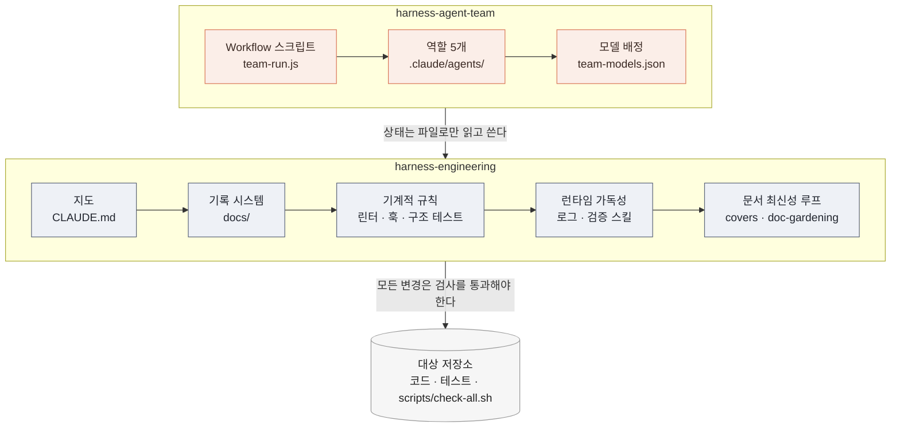
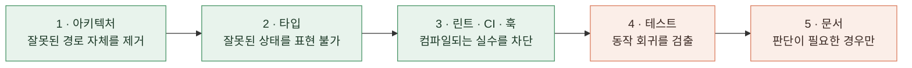
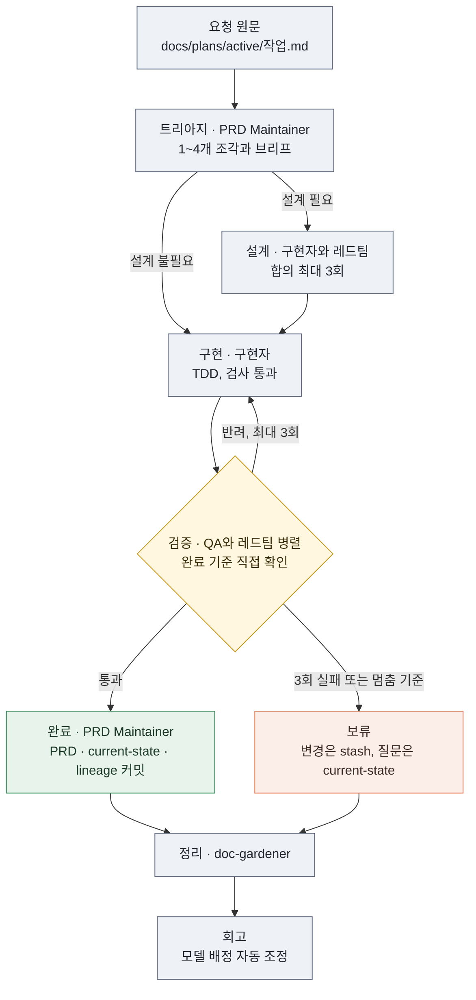
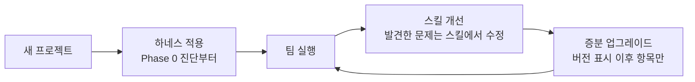

<p align="center">
  
</p>

<p align="center">
  <a href="LICENSE"></a>
  
  
  
</p>

AI 코딩 에이전트가 하나의 저장소에서 장기간, 대량으로, 아키텍처를 훼손하지 않고 작업하도록 만드는 Claude Code 스킬 두 개입니다. 에이전트에게 더 좋은 지시를 주는 데서 멈추지 않습니다. 저장소의 구조와 검사를 바꿔서, 에이전트가 올바르게 일할 수밖에 없는 환경을 만듭니다.

| 스킬 | 역할 |
| --- | --- |
| [**harness-engineering**](skills/harness-engineering/SKILL.md) | 저장소에 하네스를 구축합니다. 짧은 지도(`CLAUDE.md`), 기록 시스템(`docs/`), 기계적 규칙(린터·훅·구조 테스트), 런타임 가독성, 문서 최신성 루프를 갖춥니다. 세션 인계와 버전 업그레이드도 맡습니다. |
| [**harness-agent-team**](skills/harness-agent-team/SKILL.md) | 하네스 위에서 5개 역할의 에이전트 팀을 운영합니다. 결정적 Workflow 스크립트가 트리아지부터 회고까지 순서와 반복 횟수를 보장합니다. |

설계 결정과 트레이드오프는 [docs/architecture.md](docs/architecture.md)에 자세히 정리했습니다.

## 해결하는 문제

에이전트는 저장소에 없는 정보를 알지 못합니다. 대화로 전달한 규칙은 다음 세션에서 사라지고, 산문으로 쓴 선호는 컨텍스트가 길어질수록 묻힙니다. 여러 에이전트를 함께 돌리면 다음 담당자를 아무도 실행하지 않는 공백이 생깁니다.

| 문제 | 하네스의 대응 | 메커니즘 |
| --- | --- | --- |
| 새 세션이 이전 작업을 모름 | 상태를 파일 한 장에 고정 | `docs/plans/current-state.md`를 덮어쓰기로 유지하고, 형식을 검사로 강제 |
| 지침 파일이 비대해져 핵심 규칙이 묻힘 | 지도와 기록의 분리 | 100~150줄 `CLAUDE.md`가 `docs/` 아래 문서를 가리킴 |
| 같은 리뷰 지적이 반복됨 | 규칙을 기계적 검사로 승격 | 5단계 강제 사다리, 과거 실수로 실패 증명, 점진 강제 |
| 문서가 코드와 어긋남 | 문서가 담당 경로를 선언 | `covers` frontmatter와 git 커밋 시각 비교 |
| 멀티 에이전트 진행이 끊김 | 순서를 코드로 보장 | Workflow 스크립트가 역할의 구조화된 반환값으로만 분기 |
| 모든 단계에 고비용 모델 사용 | 실행 기록 기반 모델 조정 | 판단 역할은 고정, 실행 역할은 비대칭 규칙으로 자동 조정 |
| 스킬 개선이 기존 프로젝트에 반영되지 않음 | 버전 기반 증분 업그레이드 | 버전 표시를 읽고 이후 변경 항목만 승인받아 적용 |

## 아키텍처



하네스는 팀이 없어도 단독으로 동작합니다. 팀은 하네스가 제공하는 기록 시스템과 검사 명령을 전제로 동작합니다.

### 하네스를 적용한 저장소

```text
<project>/
├── CLAUDE.md                     # 100~150줄 지도, 첫 줄에 <!-- harness-engineering v3 -->
├── docs/
│   ├── architecture/             # 도메인·레이어 지도와 의존성 방향
│   ├── design/                   # 기능별 설계와 상태(초안 / 수락 / 폐기)
│   ├── prd/                      # 제품의 현재 상태
│   ├── plans/
│   │   ├── current-state.md      # 새 세션의 진입점, 60줄 이하
│   │   ├── active/               # 진행 중 작업: 요청 원문, 조각, 결정 로그
│   │   ├── done/
│   │   └── lineage.md            # 완료 작업의 압축 이력(append-only)
│   ├── tech-debt/
│   ├── golden-principles.md
│   └── team/                     # 팀 운영 규칙, 상시 지시, 실행 기록
├── .claude/
│   ├── agents/                   # prd-maintainer, implementer, qa-reviewer, red-team, doc-gardener
│   ├── workflows/                # team-run.js, team-models.json
│   └── skills/verify-<app>/      # 앱 실행·조작·증거 수집 절차와 기능 지도
└── scripts/check-all.sh          # 로컬과 CI가 같은 명령으로 실행하는 검사
```

## harness-engineering

OpenAI의 [Harness engineering](https://openai.com/index/harness-engineering/) 개념을 Claude Code 환경에 맞게 옮긴 스킬입니다. 한 번에 모든 단계를 적용하지 않습니다. Phase 0 진단 결과에서 가장 부족한 1~2개 Phase부터 제안하고, 승인을 받은 뒤 진행합니다.

| Phase | 목적 | 산출물 |
| --- | --- | --- |
| 0. 진단 | 지도, 문서, 검사, 로그, 반복 지적, 웹 앱 여부 점검 | 진단 보고와 시작 Phase 합의 |
| 1. 지도 | 지침 파일을 목차로 축소 | `CLAUDE.md`, 버전 표시 |
| 2. 기록 시스템 | 에이전트가 스스로 검색해 답을 찾는 구조 | `docs/`, 세션 인계 규칙 |
| 3. 기계적 규칙 | 암묵적 규칙을 실패하는 검사로 전환 | 린터·훅·구조 테스트, 규칙·강제수단 대응표 |
| 4. 런타임 가독성 | 에이전트가 실행 결과로 직접 검증 | 구조화 로그, `verify-<app>` 검증 스킬 |
| 5. Golden Principles | 코드베이스 전역 규칙 5~10개 | `docs/golden-principles.md` |
| 6. Doc-gardening | 문서와 코드의 어긋남을 지속적으로 해소 | `covers` 검사, 정리 루프 |
| 7. 에이전트 팀 | 자율 운영 | `harness-agent-team`에 위임 |
| 8. PR 워크플로우 | 에이전트 처리량에 맞춘 병합 관행(선택) | 리뷰·병합 정책 제안 |

### 규칙 강제 사다리

규칙은 가장 높은 수준에서 막고, 불가능할 때만 한 단계씩 내려갑니다. 문서는 에이전트가 건너뛰어도 아무것도 실패하지 않으므로 마지막 수단입니다.



새 검사는 과거의 실제 실수를 되살려 실패하는 것을 확인한 뒤에 채택합니다. 기존 위반이 많으면 기준 파일을 두고 늘어난 위반만 실패시킵니다.

웹 앱 프로젝트에는 고정 포트, `127.0.0.1` 바인드, 기본 경로, 인증, Tailscale funnel 외부 접속을 처음부터 규칙과 검사로 겁니다([webapp-remote-access.md](skills/harness-engineering/references/webapp-remote-access.md)).

## harness-agent-team

요청 하나를 받아 트리아지부터 회고까지 사람의 개입 없이 진행합니다. 사람의 결정이 필요한 조각만 보류하고, 나머지 조각은 계속 진행합니다.



| 역할 | 책임 | 커밋 권한 |
| --- | --- | --- |
| PRD Maintainer | 요청을 조각으로 나누고 브리프(목표·범위·완료 기준·검증 방법)를 작성합니다. 완료와 보류를 기록합니다. | 있음 |
| 구현자 | 설계와 TDD 구현을 맡습니다. 도메인별로 나눌 수 있습니다. | 없음 |
| QA/리뷰어 | 구현자의 보고가 아니라 완료 기준을 직접 확인합니다. 확인 수준(`run`·`test`·`check`)을 반환합니다. | 없음 |
| 레드팀 | 설계와 구현의 결함을 찾습니다. 위험도와 규모에 따라 소집됩니다. | 없음 |
| doc-gardener | 문서와 코드의 불일치를 고치고 끝난 계획을 보관합니다. | 있음 |

다음 경우에는 해당 조각만 멈추고 사람에게 묻습니다.

- 새 외부 의존성을 추가할 때
- 레이어 규칙이나 검사 자체를 바꿀 때
- 같은 실패가 3회 반복될 때
- 서명, 배포, push처럼 외부로 나가는 작업일 때
- 구현이 PRD의 의도와 어긋날 때
- 보안 경계를 바꿀 때

## 수명 주기



프로젝트에서 발견한 문제는 해당 프로젝트가 아니라 스킬에서 고칩니다. 변경 사항은 각 스킬의 변경 이력과 [upgrade.md](skills/harness-engineering/references/upgrade.md)에 기록합니다. 기존 프로젝트는 `CLAUDE.md`의 `<!-- harness-engineering vN -->`와 `team-run.js`의 `// team-run template vN`으로 현재 버전을 판별합니다. 이후 변경 항목 중 승인받은 것만 하나씩 적용하고 항목마다 커밋합니다.

## 사용 방법

### 설치

```bash
git clone https://github.com/krime1004/claude-harness-skills.git
cp -R claude-harness-skills/skills/harness-engineering claude-harness-skills/skills/harness-agent-team ~/.claude/skills/
```

### 요청 예시

| 요청 | 동작 |
| --- | --- |
| "하네스 엔지니어링 적용해줘" | Phase 0 진단부터 시작해 하네스를 구축합니다 |
| "CLAUDE.md 정리해줘" | 지침 파일을 짧은 지도로 다시 씁니다 |
| "새 세션으로 넘기자" | 다음 세션이 이어받을 인계 상태를 정리합니다 |
| "하네스 업그레이드해줘" | 기존 하네스를 최신 버전으로 올립니다 |
| "에이전트 팀 구성해줘" | 역할 5개와 Workflow 스크립트를 프로젝트에 만듭니다 |
| "팀으로 돌려줘" | 요청을 작업 파일에 기록하고 팀을 실행합니다 |
| "보류된 조각 이어서 해줘" | 사람의 답을 결정 로그에 남기고 보류된 조각부터 재개합니다 |
| "에이전트 팀 최신 방식으로 업데이트해줘" | 팀 스크립트와 템플릿을 최신 버전으로 맞춥니다 |

### 함께 사용하는 것

- **[karpathy-guidelines](https://github.com/multica-ai/andrej-karpathy-skills/blob/main/skills/karpathy-guidelines/SKILL.md):** 코드를 변경하는 역할은 이 스킬의 원칙(가정 확인, 최소 구현, 필요한 부분만 변경, 검증 가능한 완료 기준)을 따릅니다. 이 저장소에는 포함하지 않았으며, `~/.claude/skills/karpathy-guidelines/`에 설치된 것으로 가정합니다.
- **전역 문서 규칙:** 스킬은 `~/.claude/CLAUDE.md`에 "Markdown 문서는 400줄 이하로 쓰고, 넘으면 나눈 뒤 인덱스 파일을 둔다"는 규칙이 있다고 가정합니다. 같은 규칙을 전역 지침에 두거나 스킬 본문의 해당 문장을 수정해 사용합니다.

## 저장소 구성

```text
skills/
├── harness-engineering/
│   ├── SKILL.md                  # Phase 0~8, 업그레이드 모드, 변경 이력
│   └── references/               # 체크리스트, 규칙 강제, 검증 스킬, 웹 앱 규칙, 업그레이드 표 등
└── harness-agent-team/
    ├── SKILL.md                  # 상태 판별, 구성·실행·업데이트 모드
    ├── references/               # Workflow 오케스트레이션, SendMessage 방식
    └── templates/                # team-run.js(v4), 모델 배정, 실행 기록, 상시 지시, 이전 버전
docs/
└── architecture.md               # 설계 결정과 트레이드오프
```

## 출처와 크레딧

- **Harness engineering:** OpenAI, "[Harness engineering: leveraging Codex in an agent-first world](https://openai.com/index/harness-engineering/)". `harness-engineering`은 이 글의 원칙을 Claude Code 환경에 맞게 옮긴 것입니다.
- **[pstack](https://github.com/cursor/plugins/tree/main/pstack)** ([cursor/plugins](https://github.com/cursor/plugins), MIT, Copyright (c) 2026 Lauren Tan): 아래 방식을 참고해 다시 작성했습니다.
  - `/correct`: 수정 수준 순서와 실패 증명([rule-enforcement.md](skills/harness-engineering/references/rule-enforcement.md))
  - `create-verification-skill`: 프로젝트 검증 스킬([verification-skill.md](skills/harness-engineering/references/verification-skill.md))
  - `show-me-your-work`, `session-pickup`: 결정 로그의 증거 칸, 인계 시 멈춤·이어받기 규칙
  - `orchestrate.md`: 조각 브리프, 검증 장부, 상시 지시 파일
- **[karpathy-guidelines](https://github.com/multica-ai/andrej-karpathy-skills):** 코드 변경 담당자의 공통 원칙

## 라이선스

[MIT](LICENSE)
