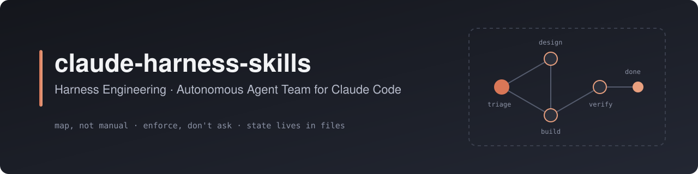
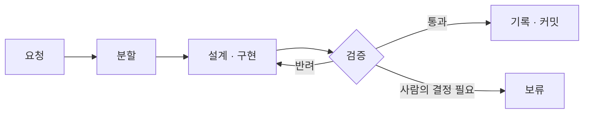

<p align="center">
  
</p>

<p align="center">
  <a href="LICENSE"></a>
  
</p>

> 에이전트에게 더 나은 지시를 주는 대신, 에이전트가 틀리기 어려운 저장소를 만든다.

OpenAI의 [harness engineering](https://openai.com/index/harness-engineering/)은 방향을 제시한 글이다. 무엇을 해야 하는지는 말하지만, 내일 아침 내 저장소에서 무엇을 실행해야 하는지는 말하지 않는다.

**claude-harness-skills는 그 개념을 Claude Code에서 실제로 운영할 수 있는 시스템으로 만든다.** 저장소에 하네스를 구축하고, 그 위에서 에이전트 팀이 사람의 개입 없이 요청을 끝까지 처리한다. 운영하며 드러난 실패는 규칙과 검사로 바뀌고, 스킬의 개선은 이미 하네스를 적용한 모든 프로젝트로 전파된다.

## 무엇이 다른가

**에이전트 팀이 멈추지 않는다.**
대부분의 멀티 에이전트 구성은 다음 단계를 누가 시작할지 모델의 판단에 맡긴다. 이 팀은 실행 순서를 스크립트로 고정하고, 다음 단계는 각 역할이 돌려준 결과로만 정한다. 사람의 결정이 필요한 작업만 따로 보관하고, 나머지 작업은 계속 진행한다.

**"완료했다"는 보고를 믿지 않는다.**
검토자는 구현자의 보고가 아니라 완료 기준을 직접 확인하고, 어디까지 확인했는지(실제 실행, 테스트, 코드 검토)를 기록한다. 배정된 검토자가 한 명이라도 결과를 내지 않으면 통과가 아니다. 검증이 끝난 뒤에는 코드를 고칠 수 없다. 목표, 범위, 완료 기준, 검증 방법이 정해지지 않은 작업은 시작조차 하지 않는다.

**팀이 스스로 비용을 최적화한다.**
설계, 레드팀, 회고처럼 품질을 판단하는 역할은 항상 가장 강한 모델로 고정한다. 나머지 단계는 실행 기록을 보고 스크립트가 모델을 조정한다. 문제가 생기면 바로 올리고, 큰 작업에서 연속으로 문제가 없을 때만 천천히 내린다. 같은 단계가 두 번 올라가면 자동 조정을 멈추고 사람에게 넘긴다.

**규칙은 실패를 증명해야 채택된다.**
반복된 실수는 문서가 아니라 구조, 타입, 린터·훅, 테스트 중 가장 강한 수단으로 막는다. 새 검사는 과거의 실제 실수를 되살려 실패하는지 확인한 뒤에만 채택한다. 기존 위반은 기준선으로 묶고 늘어나는 것만 막으며, 예외에는 사유와 만료일을 남긴다.

**문서가 낡으면 저장소가 먼저 안다.**
각 문서는 자신이 설명하는 코드 경로를 선언한다. 코드가 문서보다 나중에 바뀌면 git 기록만으로 "확인 필요"를 알린다. 별도의 색인도, 사람의 기억도 필요 없다.

**한 번 고치면 모든 프로젝트가 따라온다.**
스킬은 버전을 갖는다. 하네스를 이미 적용한 프로젝트는 자신의 버전 이후 바뀐 항목만 골라 업그레이드한다. 이전 템플릿을 보관해 두어, 프로젝트마다 직접 고친 부분은 덮어쓰지 않고 구별한다.

## 구성

| 스킬 | 역할 |
| --- | --- |
| [harness-engineering](skills/harness-engineering/SKILL.md) | 저장소를 진단하고 하네스를 구축한다. 세션 인계와 버전 업그레이드를 맡는다. |
| [harness-agent-team](skills/harness-agent-team/SKILL.md) | 하네스 위에서 다섯 역할(PRD 관리, 구현, QA, 레드팀, 문서 정리)의 팀을 운영한다. |



## 시작하기

```bash
git clone https://github.com/krime1004/claude-harness-skills.git
cp -R claude-harness-skills/skills/* ~/.claude/skills/
```

대상 저장소에서 Claude Code에 요청한다.

```text
하네스 엔지니어링 적용해줘
```

하네스가 갖춰지면 작업을 팀에 맡긴다.

```text
에이전트 팀으로 진행해: 로그인 실패 시 재시도 횟수를 제한하고 안내 문구를 추가
```

<details>
<summary>하네스를 적용한 저장소의 구조</summary>

```text
<project>/
├── CLAUDE.md                 # 짧은 지도와 하네스 버전
├── docs/
│   ├── architecture/         # 구조와 의존성 방향
│   ├── design/               # 기능별 설계
│   ├── prd/                  # 제품의 현재 상태
│   ├── plans/
│   │   ├── current-state.md  # 다음 세션의 시작점
│   │   └── active/           # 진행 중인 작업과 결정 기록
│   └── golden-principles.md  # 저장소 전체에 적용하는 규칙
├── .claude/
│   ├── agents/               # 팀 역할 정의
│   └── workflows/            # 팀 실행 스크립트와 모델 배정
└── scripts/check-all.sh      # 모든 검사를 실행하는 단일 명령
```

</details>

<details>
<summary>요청 예시</summary>

| 요청 | 동작 |
| --- | --- |
| "하네스 엔지니어링 적용해줘" | 진단 후 하네스를 구축한다 |
| "새 세션으로 넘기자" | 다음 세션이 이어받을 상태를 정리한다 |
| "하네스 업그레이드해줘" | 기존 하네스를 최신 버전으로 올린다 |
| "에이전트 팀 구성해줘" | 팀 역할과 실행 스크립트를 만든다 |
| "에이전트 팀으로 진행해" | 요청을 팀에 맡긴다 |
| "보류된 조각 이어서 해줘" | 보류된 작업을 재개한다 |

</details>

## 더 알아보기

- [설계 결정과 트레이드오프](docs/architecture.md): 각 메커니즘을 왜 이렇게 설계했고 무엇을 포기했는지

## 출처

- OpenAI, [Harness engineering: leveraging Codex in an agent-first world](https://openai.com/index/harness-engineering/)
- [pstack](https://github.com/cursor/plugins/tree/main/pstack) (MIT, Lauren Tan): 실패 증명, 검증 스킬, 작업 정의, 상시 지시 방식
- [karpathy-guidelines](https://github.com/multica-ai/andrej-karpathy-skills): 코드 변경 원칙. 코드를 수정하는 역할이 이 스킬을 함께 사용한다.

## 라이선스

[MIT](LICENSE)
