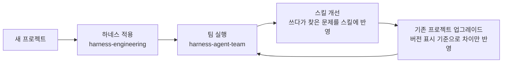

# claude-harness-skills

Claude Code가 저장소에서 오래, 많이, 구조를 해치지 않고 일하게 만드는 스킬 두 개다.

| 스킬 | 하는 일 |
| --- | --- |
| [`harness-engineering`](skills/harness-engineering/SKILL.md) | 저장소에 하네스를 깐다. `CLAUDE.md`를 짧은 지도로 정리하고, `docs/`를 기록 시스템으로 만들고, 암묵적 규칙을 린터·훅·구조 테스트로 바꾼다. 세션 인계와 기존 프로젝트 업그레이드도 맡는다. |
| [`harness-agent-team`](skills/harness-agent-team/SKILL.md) | 하네스 위에 전문 에이전트 팀(PRD Maintainer, 구현자, QA/리뷰어, 레드팀, doc-gardener)을 꾸리고, Workflow 스크립트 하나로 팀을 정해진 순서대로 돌린다. |

## 왜 만들었나

에이전트는 저장소에 없는 정보를 모른다. 대화로 알려 준 규칙은 다음 세션에서 사라진다. "~를 선호한다" 같은 문장은 컨텍스트가 길어지면 묻힌다.

그래서 두 가지를 저장소 안에 고정한다.

- **지도와 기록.** 짧은 `CLAUDE.md`가 `docs/` 아래 깊은 문서를 가리킨다. 진행 상태와 결정도 파일로만 남긴다. 새 세션은 `docs/plans/current-state.md`에서 바로 이어 간다.
- **기계적 규칙.** 리뷰에서 두 번 지적한 것은 린터, 훅, 구조 테스트, 검사 명령으로 바꾼다. 문서에만 적은 규칙은 지켜지지 않는다고 가정한다.

팀도 같은 원칙을 따른다. 지휘자(메인 세션)는 판단하지 않는다. 순서와 반복 횟수는 Workflow 스크립트가 코드로 보장한다. 그래서 다음 담당자를 아무도 실행하지 않는 공백이 생기지 않는다.

## 작업 흐름



1. **하네스 적용.** Phase 0에서 저장소를 진단한다. 가장 부족한 Phase 1~2개부터 제안하고, 승인을 받은 뒤 진행한다. 전체 단계는 맵 정리, `docs/` 구축, 기계적 규칙, 런타임 가독성, Golden Principles, doc-gardening, 에이전트 팀, PR 워크플로우다.
2. **팀 실행.** 요청을 작업 파일(`docs/plans/active/<작업>.md`)에 원문 그대로 적고 Workflow를 실행한다. 트리아지가 요청을 조각으로 나눈다. 조각마다 설계, 구현, 검증, 완료를 거친다. 사람이 정해야 하는 조각만 보류하고 나머지는 계속한다.
3. **스킬 개선.** 프로젝트에서 겪은 문제는 프로젝트가 아니라 스킬에 고친다. 바뀐 내용은 각 스킬의 변경 이력과 `references/upgrade.md`에 남긴다.
4. **기존 프로젝트 업그레이드.** `CLAUDE.md`의 `<!-- harness-engineering vN -->` 표시와 `team-run.js`의 `// team-run template vN` 표시로 버전을 찾는다. 그 버전 이후의 변경 항목만 보여 주고, 승인받은 항목을 하나씩 반영한다.

## 실제로 쓰는 요청 문구

| 요청 | 동작 |
| --- | --- |
| "하네스 엔지니어링 적용해줘" | 진단부터 시작해 하네스를 깐다 |
| "CLAUDE.md 정리해줘" | 맵 파일을 짧은 지도로 다시 쓴다 |
| "새 세션으로 넘기자" | 다음 세션이 이어받을 인계 상태를 정리한다 |
| "하네스 업그레이드해줘" | 기존 하네스를 스킬의 최신 버전으로 올린다 |
| "에이전트 팀 구성해줘" | 역할 5개와 Workflow 스크립트를 프로젝트에 만든다 |
| "팀으로 돌려줘" | 요청을 작업 파일에 적고 팀을 실행한다 |
| "보류된 조각 이어서 해줘" | 사람의 답을 결정 로그에 적고 보류된 조각부터 다시 돌린다 |
| "에이전트 팀 최신 방식으로 업데이트해줘" | 팀 스크립트와 템플릿을 최신 버전으로 맞춘다 |

## 함께 쓰는 것

- **[karpathy-guidelines](https://github.com/multica-ai/andrej-karpathy-skills/blob/main/skills/karpathy-guidelines/SKILL.md).** 코드를 고치는 역할은 이 스킬을 읽고 따른다. 가정 확인, 최소 구현, 필요한 부분만 변경, 검증 가능한 완료 기준이 핵심이다. 이 저장소에는 복사하지 않았다. 설치 위치는 `~/.claude/skills/karpathy-guidelines/`를 가정한다.
- **전역 `~/.claude/CLAUDE.md`의 문서 규칙.** 스킬은 "Markdown 문서는 400줄 이하, 넘으면 나누고 인덱스 파일을 둔다"는 규칙을 전제로 한다. 자기 전역 지침에 같은 규칙을 두거나 스킬 본문의 해당 줄을 바꾼다.

설치는 두 폴더를 Claude Code 스킬 폴더로 복사하면 된다.

```bash
cp -R skills/harness-engineering skills/harness-agent-team ~/.claude/skills/
```

## 출처와 크레딧

- **하네스 엔지니어링 개념:** OpenAI, "[Harness engineering: leveraging Codex in an agent-first world](https://openai.com/index/harness-engineering/)". `harness-engineering`은 이 글의 원칙을 Claude Code 환경에 맞게 옮긴 것이다.
- **[cursor/plugins](https://github.com/cursor/plugins)의 [pstack](https://github.com/cursor/plugins/tree/main/pstack)** (MIT, Copyright (c) 2026 Lauren Tan). 아래 방식을 참고해 다시 썼다.
  - `/correct`: 수정 수준 순서와 실패 증명(`references/rule-enforcement.md`)
  - `create-verification-skill`: 프로젝트 검증 스킬(`references/verification-skill.md`)
  - `show-me-your-work`, `session-pickup`: 결정 로그의 증거 칸, 인계의 멈춤·이어받기 규칙
  - `orchestrate.md`: 조각 브리프 필드, 검증 장부, 상시 지시 파일(`templates/standing-orders.md`)
- **[karpathy-guidelines](https://github.com/multica-ai/andrej-karpathy-skills)**: 코드 변경 담당자의 공통 원칙.

## 라이선스

[MIT](LICENSE)
