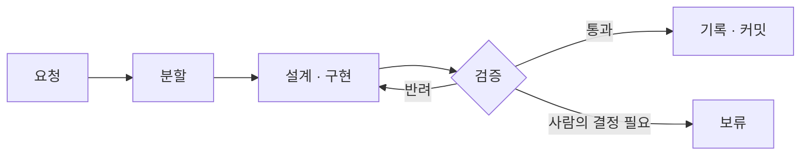

<p align="center">
  
</p>

<p align="center">
  <a href="LICENSE"></a>
  
</p>

> 에이전트에게 더 나은 지시를 주는 대신, 에이전트가 틀리기 어려운 저장소를 만든다.

AI 에이전트는 코드를 빠르게 쓴다. 하지만 저장소가 커지고 작업이 길어지면 같은 문제가 반복된다.

- 어제 세션에서 정한 규칙을 오늘 세션은 모른다.
- 리뷰에서 같은 지적이 계속 나온다.
- 문서는 코드와 어긋나고, 에이전트는 낡은 문서를 그대로 믿는다.
- 여러 에이전트를 함께 돌리면 누군가 다음 단계를 놓친다.

**claude-harness-skills는 이 문제를 프롬프트가 아니라 저장소 구조로 해결한다.** OpenAI가 제시한 [harness engineering](https://openai.com/index/harness-engineering/)을 Claude Code에 맞게 옮긴 스킬 두 개로 이루어져 있다.

## 원칙

| 원칙 | 해결하는 문제 |
| --- | --- |
| **기록은 저장소에** | 세션이 바뀌면 사라지는 맥락과 결정 |
| **규칙은 검사로** | 문서로만 존재해 지켜지지 않는 규칙 |
| **문서는 지도로** | 비대해지고 금세 낡는 지침 파일 |
| **순서는 코드로** | 여러 에이전트가 협업할 때 생기는 진행 누락 |

## 구성

### harness-engineering

저장소를 진단하고 하네스를 구축한다. `CLAUDE.md`를 짧은 지도로 줄이고, 설계·계획·결정을 `docs/`에 체계적으로 정리한다. 두 번 반복된 실수는 린터, 훅, 테스트로 막는다. 스킬이 개선되면 기존 저장소도 버전 단위로 업그레이드한다.

```text
하네스 엔지니어링 적용해줘
```

### harness-agent-team

하네스 위에서 다섯 역할로 이루어진 에이전트 팀을 운영한다. 요청을 작은 작업으로 나누고, 설계·구현·검증·기록을 거쳐 커밋까지 마친다. 진행 순서는 스크립트가 보장하고, 사람이 결정해야 하는 작업만 멈춰서 묻는다.

```text
에이전트 팀으로 진행해: 로그인 실패 시 재시도 횟수를 제한하고 안내 문구를 추가
```



<details>
<summary>팀 구성</summary>

| 역할 | 책임 |
| --- | --- |
| PRD Maintainer | 요청을 작업 단위로 나누고, 완료된 작업을 제품 문서에 반영한다 |
| 구현자 | 설계하고 테스트 우선으로 구현한다 |
| QA/리뷰어 | 구현자의 보고가 아니라 완료 기준을 직접 확인한다 |
| 레드팀 | 설계와 구현의 약점을 찾는다 |
| doc-gardener | 문서를 코드와 일치하도록 정리한다 |

</details>

## 시작하기

```bash
git clone https://github.com/krime1004/claude-harness-skills.git
cp -R claude-harness-skills/skills/* ~/.claude/skills/
```

대상 저장소에서 Claude Code에 "하네스 엔지니어링 적용해줘"라고 요청한다. 진단 결과를 바탕으로 가장 부족한 부분부터 단계적으로 진행한다.

<details>
<summary>하네스를 적용한 저장소의 구조</summary>

```text
<project>/
├── CLAUDE.md                 # 짧은 지도와 하네스 버전
├── docs/
│   ├── architecture/         # 구조와 의존성 방향
│   ├── design/               # 기능별 설계
│   ├── prd/                  # 제품의 현재 상태
│   ├── plans/
│   │   ├── current-state.md  # 다음 세션의 시작점
│   │   └── active/           # 진행 중인 작업과 결정 기록
│   └── golden-principles.md  # 저장소 전체에 적용하는 규칙
├── .claude/
│   ├── agents/               # 팀 역할 정의
│   └── workflows/            # 팀 실행 스크립트
└── scripts/check-all.sh      # 모든 검사를 실행하는 단일 명령
```

</details>

<details>
<summary>요청 예시</summary>

| 요청 | 동작 |
| --- | --- |
| "하네스 엔지니어링 적용해줘" | 진단 후 하네스를 구축한다 |
| "새 세션으로 넘기자" | 다음 세션이 이어받을 상태를 정리한다 |
| "하네스 업그레이드해줘" | 기존 하네스를 최신 버전으로 올린다 |
| "에이전트 팀 구성해줘" | 팀 역할과 실행 스크립트를 만든다 |
| "에이전트 팀으로 진행해" | 요청을 팀에 맡긴다 |
| "보류된 조각 이어서 해줘" | 보류된 작업을 재개한다 |

</details>

## 더 알아보기

- [설계 결정과 트레이드오프](docs/architecture.md)
- [harness-engineering](skills/harness-engineering/SKILL.md)
- [harness-agent-team](skills/harness-agent-team/SKILL.md)

## 출처

- OpenAI, [Harness engineering: leveraging Codex in an agent-first world](https://openai.com/index/harness-engineering/)
- [pstack](https://github.com/cursor/plugins/tree/main/pstack) (MIT, Lauren Tan): 실패 증명, 검증 스킬, 작업 정의, 상시 지시 방식
- [karpathy-guidelines](https://github.com/multica-ai/andrej-karpathy-skills): 코드 변경 원칙. 코드를 수정하는 역할이 이 스킬을 함께 사용한다.

## 라이선스

[MIT](LICENSE)
