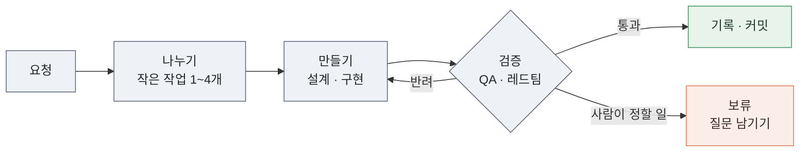

<p align="center">
  
</p>

<p align="center">
  <a href="LICENSE"></a>
  
  
  
</p>

AI 코딩 에이전트(Claude Code)가 한 저장소에서 오래 일해도 흐트러지지 않게 만드는 스킬 두 개입니다.

에이전트에게 지시를 더 잘 쓰는 방법이 아닙니다. 저장소에 문서 구조와 자동 검사를 갖춰서, 에이전트가 규칙을 어기면 바로 실패하게 만듭니다. 이렇게 에이전트가 일하는 환경 전체를 **하네스(harness)** 라고 부릅니다.

## 한눈에 보기

- **harness-engineering**은 저장소에 하네스를 만듭니다.
- **harness-agent-team**은 그 위에서 에이전트 5명으로 이루어진 팀을 운영합니다.
- 두 스킬 모두 세 가지 원칙을 따릅니다.
  1. **지시보다 검사.** 두 번 반복된 실수는 문서가 아니라 자동 검사로 막습니다.
  2. **기억 대신 파일.** 진행 상황과 결정은 모두 파일에 남깁니다. 새 세션은 파일 한 장을 읽고 이어 갑니다.
  3. **매뉴얼 대신 지도.** `CLAUDE.md`는 짧은 목차로 두고, 자세한 내용은 `docs/`에 나눠 둡니다.

## 용어 풀이

| 용어 | 뜻 |
| --- | --- |
| 하네스 | 에이전트가 일하는 환경 전체. 문서 구조, 자동 검사, 작업 기록 방식을 포함합니다 |
| 스킬 | Claude Code에 설치하는 작업 설명서. 요청 문구에 맞춰 자동으로 불려 옵니다 |
| 세션 | Claude Code와 나누는 대화 한 번. 세션이 바뀌면 이전 대화를 기억하지 못합니다 |
| `CLAUDE.md` | Claude Code가 저장소에서 가장 먼저 읽는 안내 파일 |
| 조각 | 팀이 요청을 나눈 작은 작업 하나 |
| PRD | 제품 요구 사항 문서. 제품이 지금 무엇을 해야 하는지 적습니다 |
| QA | 결과물이 완료 기준을 만족하는지 확인하는 일 |
| 레드팀 | 일부러 약점을 찾는 검토 역할 |
| doc-gardener | 문서를 코드에 맞게 손보는 역할. 정원을 가꾸듯 조금씩 자주 정리한다는 뜻입니다 |
| 린터 | 코드 규칙 위반을 자동으로 찾는 도구 |
| 훅 | 특정 시점(파일 저장, 커밋 등)에 자동으로 실행되는 검사 |
| CI | 코드를 올릴 때마다 서버에서 검사를 자동으로 실행하는 방식 |
| Workflow | 여러 에이전트를 정해진 순서로 실행하는 Claude Code 기능 |
| 의존성 | 프로젝트가 가져다 쓰는 외부 패키지나 도구 |
| 커밋 / push | 변경을 git 기록에 남기기 / 그 기록을 GitHub 같은 원격 저장소에 올리기 |
| stash | 아직 커밋하지 않은 변경을 잠시 따로 보관하는 git 기능 |
| 기술 부채 | 지금은 넘어갔지만 나중에 고쳐야 할 부분 |
| 회고 | 팀 실행이 끝난 뒤 결과를 돌아보고 다음 실행 설정을 고치는 단계 |

## harness-engineering: 저장소에 하네스 만들기

먼저 저장소를 진단하고, 가장 부족한 부분부터 하나씩 제안합니다. 한 번에 다 바꾸지 않습니다.

주로 하는 일은 다음과 같습니다.

- **`CLAUDE.md`를 짧게 정리합니다.** 100~150줄 안팎의 목차로 줄입니다.
- **`docs/` 폴더를 만듭니다.** 설계, 계획, 기술 부채를 주제별로 나눠 둡니다.
- **반복되는 실수를 자동 검사로 바꿉니다.** 린터, 훅, 테스트로 막습니다. 새 검사는 과거의 실제 실수에서 실제로 실패하는지 확인한 뒤에 씁니다.
- **에이전트가 직접 실행해 확인하게 합니다.** 로그를 읽기 쉽게 만들고, 앱을 띄워 확인하는 절차를 스킬로 남깁니다.
- **낡은 문서를 찾아냅니다.** 문서마다 자기가 설명하는 코드 경로를 적어 둡니다. 코드가 문서보다 나중에 바뀌면 "확인 필요"로 표시합니다.
- **세션을 넘길 때 파일 한 장만 갱신합니다.** `docs/plans/current-state.md`에 지금 단계, 다음 할 일, 남은 질문만 적습니다.

<details>
<summary>하네스를 적용한 저장소의 폴더 구조</summary>

```text
<project>/
├── CLAUDE.md                     # 짧은 목차. 첫 줄에 하네스 버전 표시
├── docs/
│   ├── architecture/             # 구조와 의존성 방향
│   ├── design/                   # 기능별 설계
│   ├── prd/                      # 제품의 현재 상태
│   ├── plans/
│   │   ├── current-state.md      # 새 세션이 가장 먼저 읽는 파일
│   │   ├── active/               # 진행 중인 작업
│   │   ├── done/                 # 끝난 작업
│   │   └── lineage.md            # 끝난 작업의 짧은 이력
│   ├── tech-debt/
│   ├── golden-principles.md      # 저장소 전체에 적용하는 규칙 5~10개
│   └── team/                     # 팀 운영 규칙과 실행 기록
├── .claude/
│   ├── agents/                   # 팀 역할 5개
│   ├── workflows/                # 팀 지휘 스크립트와 모델 배정
│   └── skills/verify-<app>/      # 앱을 띄워 확인하는 절차
└── scripts/check-all.sh          # 모든 검사를 한 번에 실행
```

</details>

## harness-agent-team: 에이전트 팀으로 일하기

요청 하나를 주면 팀이 나누고, 만들고, 검증하고, 기록까지 마칩니다. 사람이 정해야 할 일이 생기면 그 부분만 멈추고 나머지는 계속합니다.



팀은 역할 5개로 이루어집니다.

| 역할 | 하는 일 |
| --- | --- |
| PRD Maintainer | 요청을 작은 작업으로 나누고, 끝나면 기록합니다 |
| 구현자 | 설계하고 코드를 씁니다 |
| QA/리뷰어 | 완료 기준을 직접 확인합니다 |
| 레드팀 | 설계와 코드의 약점을 찾습니다 |
| doc-gardener | 문서를 코드에 맞게 정리합니다 |

팀 운영의 특징은 다음과 같습니다.

- **진행 순서는 스크립트가 정합니다.** 에이전트끼리 서로 부르지 않습니다. 그래서 다음 단계를 아무도 시작하지 않아 일이 멈추는 경우가 없습니다.
- **검증은 구현자의 말을 믿지 않습니다.** 검토자가 완료 기준을 직접 확인합니다.
- **반려는 최대 3번입니다.** 3번 안에 통과하지 못하면 그 작업만 보류하고 사람에게 묻습니다.
- **위험한 일은 사람에게 넘깁니다.** 새 의존성 추가, 검사 규칙 변경, 배포·push, 보안 관련 변경이 여기에 해당합니다.
- **모델을 자동으로 고릅니다.** 판단이 중요한 단계에는 항상 강한 모델을 씁니다. 나머지 단계는 결과가 계속 좋으면 더 저렴한 모델로 바꾸고, 문제가 생기면 바로 되돌립니다.

## 스킬이 바뀌면 기존 프로젝트도 따라온다

스킬을 고치면 버전이 올라갑니다. 하네스를 이미 적용한 프로젝트에서 "하네스 업그레이드해줘"라고 하면, 그 프로젝트의 버전 이후에 바뀐 항목만 골라 보여 줍니다. 승인한 항목만 하나씩 반영합니다.

## 시작하기

```bash
git clone https://github.com/krime1004/claude-harness-skills.git
cp -R claude-harness-skills/skills/harness-engineering claude-harness-skills/skills/harness-agent-team ~/.claude/skills/
```

설치한 뒤 Claude Code에 이렇게 요청합니다.

| 요청 | 결과 |
| --- | --- |
| "하네스 엔지니어링 적용해줘" | 저장소를 진단하고 하네스를 만듭니다 |
| "새 세션으로 넘기자" | 다음 세션이 이어받을 상태를 정리합니다 |
| "하네스 업그레이드해줘" | 기존 하네스를 최신 버전으로 올립니다 |
| "에이전트 팀 구성해줘" | 팀 역할과 지휘 스크립트를 만듭니다 |
| "팀으로 돌려줘" | 요청을 팀에게 맡깁니다 |
| "보류된 조각 이어서 해줘" | 멈춘 작업을 다시 시작합니다 |

함께 쓰면 좋은 것:

- [karpathy-guidelines](https://github.com/multica-ai/andrej-karpathy-skills/blob/main/skills/karpathy-guidelines/SKILL.md): 코드를 고치는 역할이 따르는 원칙입니다. 이 저장소에는 넣지 않았습니다.
- 전역 `~/.claude/CLAUDE.md`의 "Markdown 문서는 400줄 이하" 규칙: 스킬이 이 규칙을 전제로 합니다.

## 더 읽기

- [설계 결정과 트레이드오프](docs/architecture.md): 왜 이렇게 만들었는지, 무엇을 포기했는지
- [harness-engineering/SKILL.md](skills/harness-engineering/SKILL.md): 하네스 적용 단계(Phase 0~8) 전체
- [harness-agent-team/SKILL.md](skills/harness-agent-team/SKILL.md): 팀 구성과 실행 절차 전체

## 출처

- OpenAI, "[Harness engineering: leveraging Codex in an agent-first world](https://openai.com/index/harness-engineering/)": 하네스 엔지니어링 개념의 출처입니다.
- [pstack](https://github.com/cursor/plugins/tree/main/pstack) (MIT, Copyright (c) 2026 Lauren Tan): 실패 증명, 검증 스킬, 작업 정의, 상시 지시 방식을 참고했습니다.
- [karpathy-guidelines](https://github.com/multica-ai/andrej-karpathy-skills): 코드 변경 원칙의 출처입니다.

## 라이선스

[MIT](LICENSE)
