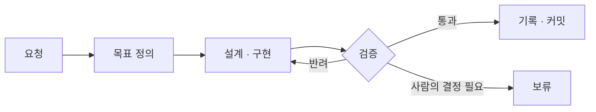

<p align="center">
  
</p>

<p align="center">
  <a href="LICENSE"></a>
  
</p>

Claude Code를 위한 하네스 엔지니어링 스킬. OpenAI가 제시한 [harness engineering](https://openai.com/index/harness-engineering/) 원칙을 Claude Code의 스킬, 훅, Workflow로 구현했다.

**에이전트는 판단하고, 결정은 코드가 한다.**

## 문제

AI 에이전트에게 일을 맡기면 결과가 에이전트의 그때그때 판단에 달린다.

- 무엇을 만들지 정하지 않은 채 구현을 시작한다.
- "완료했다"는 보고가 실제 완료를 뜻하지 않는다.
- 다음 단계로 갈지, 멈출지를 매번 다르게 판단한다.
- 같은 실수를 반복하고, 규칙은 문서에만 남는다.

## 해결

| 원칙 | 해결하는 문제 |
| --- | --- |
| **목표를 먼저 정의한다** | 범위 없이 시작하는 구현 |
| **증거로 통과시킨다** | 믿을 수 없는 완료 보고 |
| **결정은 코드가 한다** | 매번 달라지는 진행 판단 |
| **규칙은 검사로 강제한다** | 반복되는 실수와 지켜지지 않는 문서 |

## 원칙

### 1. 목표를 먼저 정의한다

**정의되지 않은 작업은 시작하지 않는다.**

- 모든 작업은 목표, 범위, 완료 기준, 검증 방법을 채운 뒤에 시작한다.
- 한 칸이라도 비면 스크립트가 시작을 거부하고 보류로 기록한다.
- 구현은 테스트를 먼저 쓰고, 완료 기준을 통과하는 것으로 끝난다.

### 2. 증거로 통과시킨다

**"완료했다"는 보고는 통과 조건이 아니다.**

- 검토자는 완료 기준을 직접 확인하고 판정, 증거, 확인 수준을 함께 제출한다.
- 확인 수준은 `run`(실제 실행), `test`(테스트), `check`(정적 검사) 중 가장 낮은 것이 기록된다.
- 배정된 검토자가 한 명이라도 응답하지 않으면 통과가 아니다.
- 검증이 끝나면 코드는 고정된다. 이후의 수정은 검증을 무효로 만든다.

### 3. 결정은 코드가 한다

**에이전트는 판단하고, 스크립트가 결정한다.**

- 모든 에이전트는 정해진 JSON 스키마로만 결과를 돌려준다.
- 다음 단계는 그 값(`pass`, `status`, `blocked`)으로만 분기한다. 지휘자는 판단하지 않는다.
- 반려는 최대 3회다. 넘으면 그 작업만 보류하고 나머지 작업은 계속한다.
- 모델 배정도 실행 기록으로 계산한다. 같은 기록이면 항상 같은 결과가 나온다.

### 4. 규칙은 검사로 강제한다

**문서에만 있는 규칙은 지켜지지 않는다.**

- 두 번 반복된 실수는 구조, 타입, 린터·훅, 테스트 중 가장 강한 수단으로 막는다.
- 새 검사는 과거의 실제 실수에서 실패하는 것을 확인한 뒤에 채택한다.
- 문서가 설명하는 코드가 바뀌면 git 기록만으로 낡은 문서를 찾아낸다.

## 구성

| 스킬 | 역할 |
| --- | --- |
| [harness-engineering](skills/harness-engineering/SKILL.md) | 저장소를 진단하고 하네스를 구축한다. 스킬이 개선되면 기존 저장소를 버전 단위로 업그레이드한다. |
| [harness-agent-team](skills/harness-agent-team/SKILL.md) | 하네스 위에서 PRD 관리, 구현, QA, 레드팀, 문서 정리의 다섯 역할로 팀을 운영한다. |



## 시작하기

```bash
git clone https://github.com/krime1004/claude-harness-skills.git
cp -R claude-harness-skills/skills/* ~/.claude/skills/
```

대상 저장소에서 하네스를 구축한다.

```text
하네스 엔지니어링 적용해줘
```

하네스가 갖춰지면 작업을 팀에 맡긴다.

```text
에이전트 팀으로 진행해: 로그인 실패 시 재시도 횟수를 제한하고 안내 문구를 추가
```

<details>
<summary>하네스를 적용한 저장소의 구조</summary>

```text
<project>/
├── CLAUDE.md                 # 짧은 지도와 하네스 버전
├── docs/
│   ├── architecture/         # 구조와 의존성 방향
│   ├── design/               # 기능별 설계
│   ├── prd/                  # 제품의 현재 상태
│   ├── plans/
│   │   ├── current-state.md  # 다음 세션의 시작점
│   │   └── active/           # 진행 중인 작업과 결정 기록
│   └── golden-principles.md  # 저장소 전체에 적용하는 규칙
├── .claude/
│   ├── agents/               # 팀 역할 정의
│   └── workflows/            # 팀 실행 스크립트와 모델 배정
└── scripts/check-all.sh      # 모든 검사를 실행하는 단일 명령
```

</details>

<details>
<summary>요청 예시</summary>

| 요청 | 동작 |
| --- | --- |
| "하네스 엔지니어링 적용해줘" | 진단 후 하네스를 구축한다 |
| "새 세션으로 넘기자" | 다음 세션이 이어받을 상태를 정리한다 |
| "하네스 업그레이드해줘" | 기존 하네스를 최신 버전으로 올린다 |
| "에이전트 팀 구성해줘" | 팀 역할과 실행 스크립트를 만든다 |
| "에이전트 팀으로 진행해" | 요청을 팀에 맡긴다 |
| "보류된 조각 이어서 해줘" | 보류된 작업을 재개한다 |

</details>

## 더 알아보기

- [설계 결정과 트레이드오프](docs/architecture.md): 각 원칙을 왜 이렇게 구현했고 무엇을 포기했는지

## 출처

- OpenAI, [Harness engineering: leveraging Codex in an agent-first world](https://openai.com/index/harness-engineering/)
- [pstack](https://github.com/cursor/plugins/tree/main/pstack) (MIT, Lauren Tan): 실패 증명, 검증 스킬, 작업 정의, 상시 지시 방식
- [karpathy-guidelines](https://github.com/multica-ai/andrej-karpathy-skills): 코드 변경 원칙. 코드를 수정하는 역할이 이 스킬을 함께 사용한다.

## 라이선스

[MIT](LICENSE)
